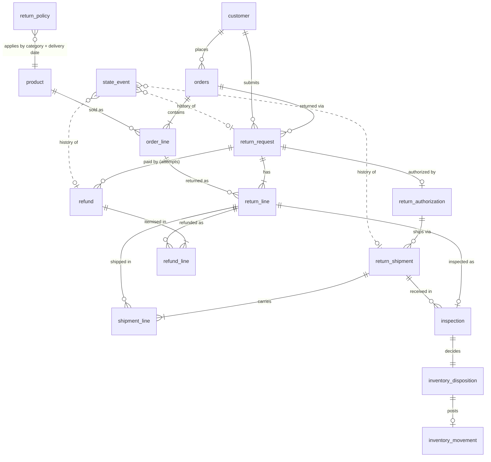

# Entity Relationship Diagram

## Lifecycles (recorded as append-only `state_event` rows)

| Entity | States |
|---|---|
| ReturnRequest | SUBMITTED → REJECTED \| AUTHORIZED → EXPIRED \| SHIPPED → CLAIM_OPENED → CLOSED \| RECEIVED → INSPECTED → (REFUNDED →) CLOSED |
| ReturnShipment | LABEL_ISSUED → VOIDED \| IN_TRANSIT → RECEIVED \| LOST |
| Refund | INITIATED → ISSUED \| BLOCKED_DUPLICATE |

## Effective dating
* `return_policy` versions are effective-dated; the version in force on the order's `delivery_date` governs eligibility
  (ELECTRONICS window 15 days until 2026-05-31, 20 days from 2026-06-01).
* `return_authorization` is effective `decided_at` .. `expires_at` (21 days).
* Snapshot date is fixed at 2026-10-22: no event exists after it, so some requests are legitimately still in flight.
